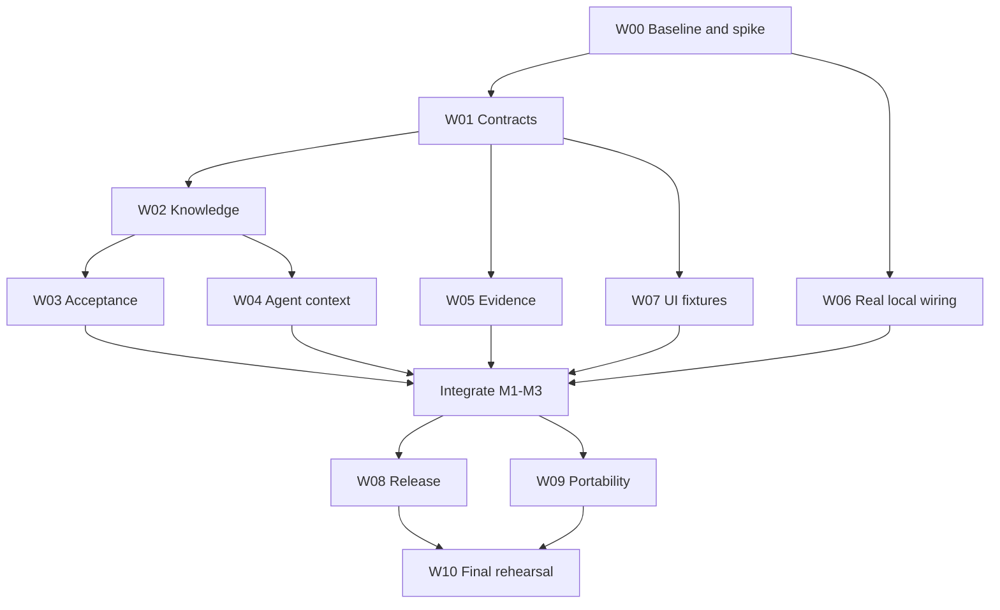

# Implementation plan

Status: proposed execution baseline, 2026-10-17, repository `d5ab4eb`.
Read [direction](README.md) and [architecture](architecture.md) before executing.

## Delivery contract

The first implementation goal is **G1: durable project understanding across agent handoffs**.
Deliver a usable public reference product in which a person confirms rules and scenarios, an
agent receives pinned context, a correction invalidates old verification, an exact proposal is
accepted and released, and a fresh agent preserves the correction without the original chat.

G1 includes milestones M0–M5 below. M6–M8 are sequenced follow-on goals, not permission for the
implementing session to keep expanding scope. Deliver G1 in independently reviewable increments;
do not promise a calendar duration before M0 establishes the integration cost.

Use CommonForge's own development as the engineering proving ground. Use a tiny synthetic
business application for predictable behavioral checks and the agency adapter contract for the
next product proving ground. No private repository modifications are part of G1.

A demonstrated workflow is required. An SDK without a working reference UI, a UI backed only
by fakes, or a successful agent narrative without verified execution does not complete G1.

## M0 — Baseline and contract lock

### W00: establish the implementation baseline

Owner: lead integrator. Dependencies: none.

- Inspect current HEAD, relevant repository instructions, working tree, and package/runtime
  versions. Preserve unrelated work. Read this package and the current limitations.
- Install pinned dependencies and establish build/typecheck/unit results using existing commands.
  Record pre-existing failures with exact commands; do not mask them or describe them as passing.
- Trace source acceptance, file/asset acceptance, staging promotion, restoration, release, and
  agent handoff. Produce a short authority map identifying every path that must enforce mode.
- Spike a real local Git provider + Node runner + preview through the Worker API, without cloud
  credentials. Existing `dev-local.sh` fakes are not evidence for this. Reuse the existing Node
  runner and provider; identify the minimal wiring required for W06.
- Confirm current protocol parsing behavior for unknown fields and signatures. Define explicit
  version negotiation so older runners fail closed on new mandatory semantics.
- Record an implementation decision if a proposed name or seam below conflicts with inspected
  code. Keep the behavior/invariant, not an arbitrary filename.

Deliver `docs/agent-native/execution-status.md` with baseline, decisions, dependency checklist,
test results, and next work package. Add entries throughout execution; it is not pre-created
with fictional results in this planning task.

Gate: a reviewed authority map, executable baseline, and a concrete local-runner wiring design.
If local execution needs unavailable OS features, record the supported environment and provide
a reproducible container path. Do not silently replace real execution with a fake.

### W01: shared contracts and fixtures

Owner: contracts lead. Depends on W00.

- Add versioned schemas for the minimal records in architecture.md and explicit lifecycle states.
- Define hashes, immutable fields, expected-revision checks, project mode, and error vocabulary.
- Define the envelope/inner-proposal dual binding and new project acceptance scope.
- Define paginated list/read APIs and mutation request/response shapes before parallel consumers.
- Add synthetic canonical fixtures: initial rule, corrected rule, passing and stale evidence,
  metadata-only acceptance, source acceptance, denied scope, and failed observation.
- Export through existing package entrypoints. Split modules by concept rather than expanding
  the already large schema file indefinitely; retain existing imports for compatibility.

Suggested files: new `packages/core/src/project-*.ts` modules; existing package index/tests.

Gate: schema/hash vectors including old v1 vectors pass; fixtures contain no secrets; interface
review resolves all authority-affecting ambiguities before downstream agents start.

## M1 — Durable knowledge and atomic acceptance

### W02: knowledge, outcomes, and authoritative revisions

Owner: backend/ledger agent. Depends on W01.

- Add immutable knowledge/scenario revisions, outcome records, confirmation decisions, knowledge
  heads, genesis project manifests, and project-mode storage in OrgLedger.
- Implement draft, confirm, supersede, and archive operations with compare-and-swap and idempotency.
- Implement knowledge-only acceptance without claiming the deployed app meets new requirements.
- Add in-memory store and SQLite implementations with append-only migrations. Existing data reads
  and writes retain their current semantics until explicit project enablement.
- Add scoped API services and list/detail endpoints. Use outbox-backed D1 projections only where
  useful; direct bounded ledger reads are acceptable initially.

Gate: conflicting confirmations have one winner; retries do not duplicate revisions; access
filtering works; legacy database upgrade preserves records; confirmed knowledge survives restart.

### W03: project proposal acceptance

Owner: ledger/integrator. Depends on W02; uses W01 evidence fixtures until W05 is integrated.

- Implement immutable project proposals and `planProjectAccept` with store ports shared by
  in-memory/SQLite adapters. Keep artifact acceptance checks inside the same transaction.
- Verify envelope, parent, knowledge generation, policy, mandate, authority, decision, and
  applicable evidence. Persist the complete new manifest atomically with source/knowledge writes.
- Preserve old hashes and legacy operation semantics. Add protocol discrimination without
  silently defaulting missing v2 semantics to trusted values.
- Gate every legacy mutation path on project mode. In G1, agent-native projects use the direct
  proposal path; shared staging/promotions return explicit unsupported-mode responses.
- Add controlled enablement for a legacy project with no in-flight work. Refuse downgrade bypass.
- Implement recovery proposals referencing old artifacts under current knowledge requirements.

Gate: acceptance is all-or-nothing under injected failures; concurrent source/knowledge updates
cannot accept stale work; no legacy route can bypass the envelope for an enabled project.

## M2 — Agent context and verified behavior

### W04: scoped handoff, attempts, and context packets

Owner: agent protocol/backend agent. Depends on W02 and frozen W01 contracts.

- Implement single-use task handoff exchange, task-scoped principals, attempt records, one-hour
  default mandates, renewal, revocation, and bounded jobs/attempts.
- Keep issuer identity separate from agent identity. Verify access in APIs, brokers, attachment
  reads, context generation, and submit—not only in the web app.
- Generate pinned JSON/Markdown context deterministically. Refuse oversized packets and required
  inaccessible context. Do not leak restricted records through errors or dependency summaries.
- Extend checkout/submit and MCP to carry attempt/context identity and show actionable stale-context
  errors. Support proposing a correction without permission to confirm it.
- Add a context inspection command and export sufficient to start a fresh agent session without
  the earlier conversation. Make all new agent-facing actions available through structured tools.

Gate: a handoff cannot access a second task/project, confirm a rule, accept a proposal, or release.
Revocation/expiry/renewal and concurrent exchange tests pass. Materialized context matches its
digest and contains no broad session token or provider credential.

### W05: scenario verification and evidence

Owner: runner/evidence agent. Depends on W01; integrate W02/W03 before completion.

- Add explicit job/result version support and scenario evaluation bindings to envelope, scenario,
  verifier, integration result, runtime recipe, and execution identity.
- Implement one concrete automated verifier using a pinned trusted harness and synthetic fixture
  inputs. Prefer behavior/API tests initially; add browser checks for the review-critical journey.
- Keep required harness definitions outside candidate write control. Execute candidate code under
  the existing isolation model; signing keys stay in the supervisor. Restrict egress as before.
- Record individual results, bounded/redacted logs, attachments, timeouts, and execution errors.
  Verify the exact expected scenario set when ingesting results.
- Add manual attestations bound to exact envelope/build and authorized observer. Show their
  provenance distinctly from automated checks.
- Reverify after any confirmed knowledge/scenario change or changed integration result. New checks
  produce new records; failed/stale records remain inspectable. Define an explicit superseding run
  relation so a passing retry is chosen deterministically without erasing prior failures or
  weakening the legacy artifact evidence policy.

Gate: fabricated, missing, mismatched, replayed, or obsolete results cannot satisfy acceptance.
A candidate that changes its own test script cannot weaken the independently pinned scenario.

## M3 — Complete reference experience

### W06: real local workflow and fixture

Owner: integration/test agent. Depends on W00; complete after W03–W05.

- Add a documented real-local mode wiring the control plane to `provider-local-git`, the Node
  runner, local blob storage compatible with the existing interface, and real previews.
- Preserve the fast fake stack with explicit labels. Use a separate command/configuration so
  users and tests can tell which backend is running. Do not require a second production cloud.
- Add a small synthetic scheduling fixture with a deterministic clock and state, cutoff/travel
  rules, manager exception, and reason recording. Keep it small enough to reset per run.
- Exercise a complete API/CLI workflow with real source operations and verification. Reset uses
  disposable task-owned state, never another project's data or the developer's running instance.
- Add a rehearsal command that produces machine-readable results and artifact locations.

Gate: a contributor with the documented runtime can start the stack, see a real preview, confirm
and correct a rule, submit/verify/accept a change, and run the fresh-session continuity rehearsal
without Cloudflare credentials. Local release simulation remains labeled; real cloud release is
verified separately by W08 and must not be claimed from this rehearsal.

### W07: domain-oriented reference UI

Owner: UI agent. Depends on W01 for fixture work; W02–W06 for completion.

- Add Outcomes and Knowledge pages with creation, draft/confirmed distinctions, provenance,
  scenarios, revision history, and correction flow.
- Update Overview around decisions needed, active outcomes, behavior gaps, and release observations.
- Extend change review with exact purpose/rules, real preview, per-scenario evidence, unresolved
  gaps, corrections, and separate accept/release actions.
- Preserve technical inspection, file views, and legacy agency workflows. New onboarding creates
  an agent-native project; the old agency/staging mode remains explicit and usable.
- Treat empty, loading, denied, stale, failed, expired-preview, and unknown-health states as real
  product states. Provide keyboard operation, labeled controls, focus handling, and non-color status.
- Use fixtures for fast component work, then verify the same flows through the real API. Capture
  screenshots for the key owner decisions and correct layout/interaction defects.

Gate: an owner can complete the reference journey without editing JSON or issuing Git commands.
No “verified” badge is sourced from agent prose or a fake result presented as a real run.

## M4 — Release linkage, portability, and agency boundary

### W08: release observations and recovery

Owner: release/backend agent. Depends on W03/W05; UI integration with W07.

- Bind existing release preparation/approval/deployment to the accepted project manifest and exact
  artifact references. Refuse release with unverified or mismatched mappings.
- Persist one bounded post-release check as a ReleaseObservation; show freshness and failures.
  Reuse existing health mechanisms, without claiming continuous monitoring.
- Implement explicit recovery to a prior artifact version as a new proposal evaluated under
  current confirmed knowledge. Distinguish recovery planning from successful deployment.
- Expose declared external effects and unsupported recovery cases. Do not add production database
  migration or external side-effect automation to the fixture.
- Run the cloud flow in an isolated authorized test deployment when credentials are available.
  If unavailable, provide the exact command/prerequisites and leave that gate unverified.

Gate: release, observation, and recovery reference the correct manifests; retries do not deploy
an unintended artifact; faults never mark a failed deployment healthy. Live release completion
requires actual cloud evidence, not local fakes.

### W09: project bundle and private-product contract

Owner: portability/backend agent. Depends on W02–W05; integrate W08 release metadata.

- Implement versioned bundle export/import with manifests, knowledge, decisions, scenario/evidence
  metadata, retained attachments, and source inclusion/reference completeness reporting.
- Validate digests, bounds, archive paths, versions, and access; exclude credentials and sensitive
  local coordinates. Remap identities and require fresh local authority on import.
- Prove imported historical evidence cannot authorize local acceptance automatically.
- Document the agency consumer API and capability mappings using synthetic client data. Add
  consumer contract tests demonstrating branding/workflow customization without ledger patches.
- Keep public APIs independent of private package imports or private deployment configuration.

Gate: export/import preserves semantic history, shows missing payloads honestly, and re-verifies
locally before new acceptance. The public reference product runs with no private repository.

## M5 — Self-development rehearsal and release candidate

### W10: integrated acceptance, documentation, and dogfooding

Owner: lead integrator with independent review. Depends on W00–W09.

- Run the acceptance matrix below. Review race conditions, mode bypasses, evidence claims, and
  authority boundaries. Fix failures before declaring completion.
- Create an isolated CommonForge project for this repository. Set a small real follow-up outcome,
  record rules/scenarios, and execute an implementation/review cycle through the new workflow.
- Start a fresh agent session with no original chat. Give it only the task and allowed project
  context; have it perform a related change preserving the owner's correction. Record the actual
  agent/client, inputs, results, and any human restatement needed. If no fresh-session facility
  is available, distinguish a deterministic protocol test from the unperformed agent rehearsal.
- Keep the controlling instance separate from the candidate instance. Preserve GitHub export,
  external CI, and recovery/bootstrap instructions. G1 does not require migrating all development
  or automatically publishing this repository's own releases.
- Update README positioning and onboarding only to match implemented behavior. Update API/CLI
  docs, self-hosting, limitations, architecture decisions, and screenshots. Identify mocks clearly.
- Produce a concise completion report with delivered work, tests, empirical gaps, and next goals.

Gate: all non-environment-dependent G1 criteria pass. Report separately whether live cloud
release, fresh-agent execution, and a human usability walkthrough were actually observed.
Do not call the full G1 goal achieved while a required live/fresh-agent gate remains unverified;
report a locally validated release candidate and the specific remaining gate instead.

## Acceptance matrix

| ID | Observable requirement | Verification owner |
|---|---|---|
| AN-01 | A confirmed rule and its source survive restart; drafts remain distinguishable | W02 integration |
| AN-02 | Two writers confirming against one head cannot both overwrite it | W02 concurrency |
| AN-03 | Checkout carries an exact context digest and no inaccessible or credential content | W04 security |
| AN-04 | A task handoff cannot access another task, confirm, approve, or deploy | W04 authorization |
| AN-05 | Confirming a correction invalidates earlier source verification/approval applicability | W03/W05 integration |
| AN-06 | Metadata-only confirmation records unmet implementation requirements honestly | W02/W07 integration |
| AN-07 | Altered candidate tests cannot replace required trusted scenarios | W05 adversarial test |
| AN-08 | Missing, wrong-subject, wrong-verifier, stale, or fabricated evidence is rejected | W03/W05 conformance |
| AN-09 | Manual attestation binds an authorized observer to the exact reviewed build | W05 authorization |
| AN-10 | Source heads and project manifest either both commit or neither does | W03 fault/concurrency |
| AN-11 | Legacy routes cannot bypass new-mode gates; legacy projects still work | W03 route matrix |
| AN-12 | Revoked/expired mandate cannot submit or authorize accepted work | W04/W03 race tests |
| AN-13 | Changing integration output requires verification of the new output | W03/W05 regression |
| AN-14 | Owner completes correction/review/acceptance in the UI using real API results | W06/W07 browser |
| AN-15 | Accepted, deployed, healthy, unhealthy, and unknown states remain distinct | W08 integration/UI |
| AN-16 | Recovery preserves current knowledge and cannot hide unhandled external effects | W08 integration |
| AN-17 | Bundle round-trip retains history; imported authority/evidence is not locally trusted | W09 conformance |
| AN-18 | Existing database upgrades and v1 hashes/protocol records remain readable | W01/W02/W03 migration |
| AN-19 | Real local Git, runner checks, and previews execute with no cloud credentials | W06 rehearsal |
| AN-20 | Fresh agent preserves a corrected rule without original conversation or restatement | W10 agent rehearsal |
| AN-21 | Real isolated cloud release produces correctly bound observation and recovery evidence | W08 live rehearsal |
| AN-22 | Public reference app and synthetic agency consumer need no private dependencies | W09 build/contract |
| AN-23 | Self-development candidate cannot mutate the controlling instance during verification | W10 isolation rehearsal |
| AN-24 | Export/delete/GC retain referenced accepted evidence and remove no active payload | W09 retention/fault |

AN-20 is evaluated by inspecting both the fresh agent's input and its resulting implementation
against fixed behavioral scenarios. A generated explanation alone does not pass. AN-21 requires
authorized isolated infrastructure; lack of credentials is an explicit environmental gap.

## Execution graph and subagent ownership



The graph allows early fixture/wiring work; completion dependencies in each work package still
apply. W05 is not complete until integrated with authoritative knowledge and acceptance.

The lead owns shared schemas, migrations, acceptance semantics, and integration decisions. With
three subagent slots, a useful first parallel wave is backend knowledge/acceptance, runner evidence,
and UI fixtures after W01. Then schedule agent context, local workflow, and portability according
to completed dependencies. Keep one integrator; do not let every agent independently redesign
the core model.

Use isolated branches/worktrees for overlapping code when available. If sharing a worktree,
assign disjoint file ownership and have the lead serialize shared-file edits. Reserve migration
IDs centrally at implementation time; this plan intentionally does not guess future IDs.
Every agent handoff names the work package, allowed files, dependencies, invariants, acceptance
IDs, and required output. Each returns changed paths, validation, risks, and remaining work.

An independent reviewer should examine acceptance/evidence/auth changes after their authors
finish. Reviewers must identify concrete failures or confirm tested invariants, not request a
general rewrite. The lead resolves findings and runs integration checks once shared changes land.

## Verification commands and evidence discipline

Revalidate scripts in package.json when execution begins. At the inspected revision:

```sh
pnpm install --frozen-lockfile
pnpm typecheck
pnpm build
pnpm exec turbo run test --concurrency=1
pnpm test:fault
pnpm test:security
pnpm --filter @commonforge-org/web exec playwright install chromium
pnpm --filter @commonforge-org/web run test:e2e:fixture
pnpm --filter @commonforge-org/web run test:e2e:stack
```

Run targeted suites during each work package; run the relevant full checks at integration.
Add the new real-local rehearsal and critical new browser journey to CI, with bounded artifacts
and deterministic cleanup. Existing local-stack and fixture tests remain useful but do not
prove actual provider/runner behavior. `pnpm test:live` covers existing live-provider suites;
add a dedicated new G1 live rehearsal rather than claiming existing tests cover new behavior.

For each AN criterion, record command, commit, execution mode, outcome, and artifact location.
Use `pass`, `fail`, `not_run`, or `blocked_environment`; never count a skipped test as a pass.
Do not check secrets or sensitive run artifacts into public docs. Use stable sanitized summaries
and access-controlled artifact storage where appropriate.

## Later goals

### M6 — Private agency product consuming the public engine

Start after G1's contracts have survived use. In a separate authorized private-repository goal,
add agency/client capability profiles, onboarding, branding, contractual review rules, and billing
integration. Do not encode agency roles into the public engine. First demonstrate one client-led
change with restricted context and an agency release decision, then a project with different
domain rules. Validate with real domain experts before claiming that G1's technical success proves
nontechnical usability. Extract existing agency UI only when this consumer is ready.

### M7 — Ongoing stewardship and parallel attempts

Add recurring obligations, observation freshness scheduling, escalation, bounded retry/budget
policies, and agent-proposed maintenance. Then introduce alternative attempts and explicit
dependencies between outcomes. Measure unnecessary knowledge invalidations before replacing
the conservative whole-project generation check. Release delegation requires stronger authority,
cost accounting, and recovery guarantees than a model's confidence score.

### M8 — Public reusable capabilities and ecosystem

Build two portable capabilities with domain assumptions, scenarios, and maintenance history.
Prove adaptation to different rules and upgrades with local re-verification before adding a
catalog. Then design contributor identity, attribution, abuse controls, and evidence provenance
for public collaboration. A new storage engine or federation protocol requires a separate design
grounded in measured limitations, not the desire to eliminate Git for its own sake.

## Risks to revisit at milestone gates

- Whole-project knowledge invalidation is safe but may interrupt unrelated work. Measure before
  optimizing; do not drop the guard to make a demo pass.
- A correct verifier can still test an incomplete business rule. Show gaps and collect domain
  corrections; avoid universal correctness claims.
- Local execution fidelity may expose Cloudflare-specific coupling. Extend provider boundaries
  narrowly; do not fork the ledger or implement another production platform during G1.
- Self-development can hide domain-expert UX problems and create bootstrap dependencies. Use a
  separate controlling instance, retain external recovery, and follow with the agency pilot.
- Public reuse permits competitors to adopt the engine. Keep that tradeoff explicit; the plan's
  differentiation depends on a useful product and ecosystem, not private ownership of core code.
- The first useful slice is still substantial. Ship milestone increments and preserve a resumable
  execution record; do not substitute a partially mocked demo for acceptance criteria.
